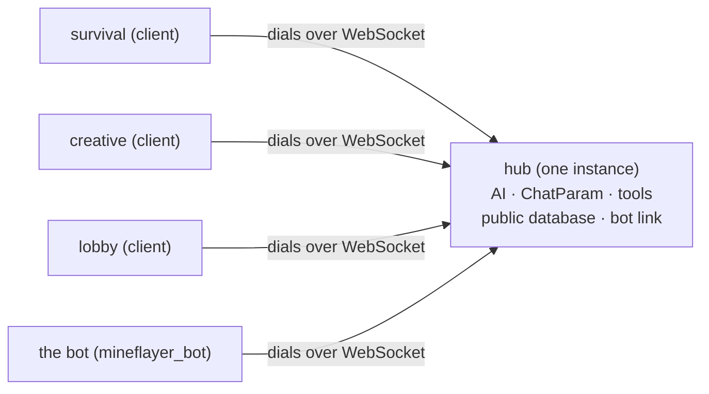

<div align="center">

# Cross-server Linking

English  |  [简体中文](../zh_cn/cross-server.md)  |  [繁體中文](../zh_tw/cross-server.md)

[Back to README](../../README.md)

</div>

Several MCDR instances can be joined into one **cluster** that shares a single AI, one conversation history, one public database and one set of tools. This document covers the role decision, the protocol, command routing and troubleshooting.

## What it is



- **hub**: the only instance that listens. It owns everything stateful: an `!!ask` typed anywhere is
  answered by the hub, and the AI request, the history and the tool execution all happen there.
- **client**: an instance that dials the hub. It forwards its players' commands and shows the answers.
  It needs no API key of its own.
- **local**: standalone mode, used when cross-server linking is unavailable (see below). Every feature
  behaves exactly as it did before.

Only the hub exposes a port; clients dial out, so a client's machine needs no inbound port at all.

**Where a conversation lives**: `!!ask` is a server-class command, so every conversation (every `ChatParam`) is created on the **hub** and stored in the hub's own `config/games_ai/database/public_database.db` (the `chat_history` table). A client holds none -- which is also why moving the hub role to another machine means moving that file with it. A message handed from one user's assistant to another user's (`send_message_to_player_ai`) therefore travels across the whole cluster, as long as it runs on the hub and the recipient already has a conversation.


## How the role is decided

On load the plugin probes the configured `websocket.uri` **on a background thread** (the probe never
blocks MCDR's plugin loading). In order:

|Situation|Result|
|---|---|
|`force_server: true` and the port is free|**server** (this instance listens on that uri)|
|`force_server: true` but the port is taken|error, falls back to **local**|
|the `uri` answers and confirms it is GamesAI|**client** (joins that hub)|
|the `uri` answers but is **not** GamesAI|**local** (cross-server is off entirely: no port is taken, no command is forwarded)|
|nothing answers and the port is free|**server**|
|nothing answers but the port is taken|**local**|
|the `uri` is not a valid address / empty|**local**|
|the `uri` is `wss://`|probed first, so it is a **client** when a GamesAI hub answers and **local** when nothing does -- this plugin **never listens with TLS**, so a hub must use `ws://` (the tunnel or reverse proxy terminates TLS)|

The decision is logged, for example:

```
[GamesAI] cross-server role: server (nothing answered at ws://10.0.0.1:8765 and ws://10.0.0.1:8765 is free)
```

**Identity**: a client registers under `websocket.name`, which is derived from the instance directory
when it is empty (`<directory>-<first 6 digits of a path hash>`, e.g. `survival-9f31ab`) -- so two
instances on one machine never share a name, and a machine rename does not break the enrolment. A
newer connection still takes a name over (the old one is closed with code `4003` and a reason), and
the hub **refuses** to issue a token for a name that is already enrolled: that would knock the online
node offline (`4001`, not retryable). Use `!!gamesai node rotate <name>` to replace a node on purpose.

**Local mode is not "nothing at all"**: it still runs a loopback hub (random port on `127.0.0.1`) for
local peers only, so the bot (section 6) has somewhere to register in server, client and local mode.
An empty `websocket.uri` is the one exception: cross-server is off entirely then, and the bot has
nothing to connect to either.


## Configuration

```json
{
    "websocket": {
        "uri": "ws://10.0.0.1:8765",
        "force_server": false,
        "allow_app_id": [],
        "name": "",
        "token_ttl_hours": -1,
        "auto_enroll": true,
        "identity_file": ""
    }
}
```

|Key|Meaning|
|---|---|
|`uri`|Default `ws://127.0.0.1:8080`. The cluster address. The hub uses it as its **listen** address (bound strictly to the host in the uri, so use `ws://0.0.0.0:8765` or the machine's LAN address to be reachable), clients use it as the dial target.|
|`force_server`|Default `false`; Skip the probe and insist on being the hub.|
|`allow_app_id`|A list of strings (default `[]`). Extra handshake ids this hub admits, so your own service can connect without being refused with `4005`.|
|`token_ttl_hours`|Default `-1`. Validity of the tokens issued to nodes, in hours; `-1` means unlimited.|
|`name`|Default `""`. This instance's name inside the cluster; empty derives it from the instance directory (`<instance directory>-<first 6 digits of a path hash>`, e.g. `survival-9f31ab`), so two instances on one machine cannot collide and a machine rename does not matter.|
|`auto_enroll`|Default `true`. Ask the hub to enrol this instance when it has no identity.|
|`identity_file`|Default `""`. Override the identity file path (default `config/games_ai/cross_server/identity.json`); a relative value is used verbatim.|

Every instance authenticates with **its own** token: request, issue on the hub, claim on the node. See the enrolment section below.

Upgrading from an older release needs no manual edit: the old `mineflayer_bot.websocket.url` is migrated to
`websocket.uri` and the dead block is removed.


## Protocol

One JSON text object per frame.

|Frame|Direction|Payload|
|---|---|---|
|`hello`|client → hub|`type, app, protocol, server, token, version, features[], enroll` (a startup probe adds `probe: true`; `enroll` is true when the instance has no token and asks to be enrolled)|
|`hello_ack`|hub → client|`type, app, protocol, hub, peers[], you, expires_in` (`you` is the name the hub registered, `expires_in` the token lifetime)|
|`enroll_pending`|hub → client|`type, protocol, hub, name, requests, refused, message` (sent right before the `4007` close of an enrolment request)|
|`message`|both|`type, request_id, source, target, action, message, data{}`|
|`reply`|both|`type, request_id, source, target, ok, message, data{}, error`|
|`event`|both|same shape as `message`, **never answered**|

The important rules:

- `app` must be `"games_ai_mcdr"` (`mineflayer_bot`, or an id listed in `websocket.allow_app_id`) and `protocol` must match -- together they are the only "are you GamesAI?" test the hub applies.
- `version` and `features[]` are **informational**: the plugin version this instance runs, and the
  optional capabilities it understands (`update_order` today). Neither is validated -- an instance
  running an older build simply sends nothing, and the hub then treats it as "cannot be ordered
  around" instead of as a protocol error. The wire protocol version stays 1, so a half-updated
  cluster keeps talking.
- The hub **always overwrites `source`** with the sender's registered name, so a node cannot
  impersonate another one.
- `target`: a name delivers to that peer only, `"*"` to every peer except the sender, and an
  empty/missing/hub name means "the hub handles it locally".
- Every `message` is answered with exactly one `reply`, matched by `request_id`; an `event` is not
  answered. An unknown target is answered **immediately** with an error instead of letting the sender
  wait for a timeout.
- A probe (`probe`) is answered but **never registered**, so startup probes do not pollute the online
  list.
- **One frame is capped at 1 MiB**: an oversized frame is never sent -- a `reply` becomes a short
  honest error and a streamed `command_reply` one honest line, while anything else is dropped with a
  warning in the sender's log -- so one huge output cannot tear down the link.
- **When a peer drops, the calls waiting for it are woken immediately** and told the outcome is
  unknown ("do not retry") instead of sitting on their timeout.

## Handshake ids

The `app` field of a `hello` frame is the handshake id: it says **what is connecting**, and
the hub adapts to it.

|`app`|Who is connecting|How the hub treats it|
|---|---|---|
|`games_ai_mcdr`|another GamesAI instance|takes part in command routing, cluster-wide commands and the online list|
|`mineflayer_bot`|a Mineflayer bot|only answers `bot_action` and **never** receives a cluster command; every `command` / `command_cluster` / `exec_cluster` / `tool_call` / `event` frame it sends is refused and logged|
|anything in `allow_app_id`|your own service|handled as an ordinary peer: addressed `message`/`reply` work, and it counts as a trusted member for cluster-wide commands|

The `app` of a `hello_ack` is **always the hub's own identity, `games_ai_mcdr`**, and it carries a
`you` field telling the peer which identity this hub accepted it as. A connection whose `app`
is neither listed above nor in `allow_app_id` is closed with `4005`.

`allow_app_id` only relaxes the hub's **inbound** check: the hub applies no bespoke handling
for those ids (they are ordinary peers), and our own client still announces `games_ai_mcdr` and
still requires the hub it dials to answer `games_ai_mcdr`. Anything you list is **fully trusted**
(it may trigger command execution just like a GamesAI instance), so list only services you
control.

GamesAI-Java will announce `games_ai_java`; until that id is built in, admit it through
`allow_app_id`.

### Enrolment (one token per instance)

The cluster no longer uses a shared passphrase; every instance holds **its own** token:

1. **Request**: an instance without a token sends one enrolment request at startup (unless `websocket.auto_enroll` is `false`). The hub records its name in the waiting list and closes with `4007` -- a code that is **not retryable** (without a token it can never get in, so reconnecting is pointless). The instance stays in local mode: everything works, but only for itself;
2. **Issue**: the operator runs `!!gamesai node pending` on the hub to see the waiting names, then `!!gamesai node token <name>` -- **only a waiting name may be issued to**. The hub stores a `sha256` hash only, and the plaintext token appears exactly once, in that reply;
3. **Claim**: on that instance, run `!!gamesai node claim <token>`. It writes the token to `config/games_ai/cross_server/identity.json` and reconnects immediately as a full member.

The link's runtime state all lives in `config/games_ai/cross_server/`: `identity.json` (this instance's token, node side), `nodes.json` (the hub's node table: one hash per enrolled node plus the waiting requests) and `role.json` (the role this instance held on its last load). An installation from before that folder existed is migrated on first use, so nothing has to be claimed again; `websocket.identity_file` still overrides the identity path completely.

|Command|Where|Effect|
|---|---|---|
|`!!gamesai node pending`|hub|List the waiting names (name, app, source IP, waiting time)|
|`!!gamesai node token <name>`|hub|Issue a token for that name and show it once|
|`!!gamesai node list`|hub|Enrolled nodes: name, app, last announced version, issued at, validity, last source and time, fingerprint|
|`!!gamesai node revoke <name>`|hub|Revoke (that instance gets `4001` on its next connect)|
|`!!gamesai node rotate <name>`|hub|Issue a new token (the old one dies immediately)|
|`!!gamesai node claim <token>`|node|Claim or replace this instance's identity and reconnect|
|`!!gamesai node status`|any|Answers by role: on the hub the name it serves under, the address it listens on and how many nodes are enrolled / online; on a client the hub name, whether it is enrolled, the fingerprint and the time left; in local mode the role, the enrolment and why there is no link|
|`!!gamesai node forget`|node|Drop this instance's identity and disconnect (suspected leak, or a new hub)|

**Validity** comes from the hub's `websocket.token_ttl_hours` (hours, default `-1` = unlimited), fixed at issuance, and **checked only during the handshake** so it never cuts a live connection. Keep `-1` when hub and nodes share one machine; across machines, set a value so a leaked identity file stops being useful after a while.

**Expiry and revocation**: an expired token gets `4008`, a revoked or unknown one gets `4001`, and neither is retryable -- run `node rotate` (or `node token`) on the hub and claim again.

**Enrolment limits** (the `pending` table is the only one outsiders can write to): one address may ask for 10 **new names** per minute, the waiting list holds at most 32 entries, and a request nobody acted on disappears after 7 days (the age is shown by `!!gamesai node pending`). Asking again for the same name is never limited and never rewrites the file; a refused request changes nothing and only logs a warning.

**The bot needs no human**: `mineflayer_bot` is issued automatically by the hub (only for requests from the loopback interface or from a machine that already hosts an enrolled node), and the hub that issued the token writes it into its own bot's JS config; a bot running next to another instance gets the token in the handshake and keeps it in memory for that session. **The bot identity only answers `bot_action`**: `command`, `command_cluster`, `exec_cluster`, `tool_call` and `event` frames from it are refused by the hub and logged as a warning.

**Security boundaries**: logs, `node list` and `node status` show a fingerprint only, `!!gamesai config get` never echoes a token, and apart from the one `node token` / `node rotate` reply (which MCDR writes into the hub's console log) the plaintext lives only in the node's identity file. The link is not encrypted, so **across machines wrap it in a tunnel** (a same-machine deployment has no such concern). Note that a tunnel or reverse proxy makes the hub see every peer as loopback, which is why **reaching the port is enough to obtain the bot identity** -- and why a bot identity may only answer `bot_action`: the hub refuses command, tool-call and event frames from it (see below).

Close codes:

|Code|Meaning|
|---|---|
|`4000`|the first frame was not a valid hello|
|`4001`|token mismatch|
|`4002`|no server name|
|`4003`|the name was taken over by a newer connection|
|`4004`|protocol version mismatch|
|`4005`|the peer is not a GamesAI instance|
|`4007`|enrolment required: this instance has no token and did not ask for one (or the hub refused the request)|
|`4008`|the enrolment token expired|

A client **gives up** on `4001/4002/4003/4004/4005/4007/4008` and logs why; anything else (hub restart, network
blip) is retried with exponential backoff.


## How commands travel

|Class|Behaviour|Commands|
|---|---|---|
|**A**|executed on the hub|`!!ask` (incl. `-n/-f/switch/stop/compact/context`), every `!!data` subcommand, `!!gamesai clear [name]`, `!!gamesai check`, `!!gamesai speedtest`, `!!gamesai config get/set`, `!!aibot join/leave/set`|
|**B**|executed where it was typed|the help texts|
|**C**|cluster-wide (hub and every client run it)|`!!gamesai clearall`, `!!gamesai reload`, `!!gamesai debug`, `!!gamesai debug thread`|

- **Class A replies carry no prefix**: `!!ask`, `!!data` and friends are executed by the hub, which
  is *answering for you*, so every line you see on a client reads like a local command (no
  `[hub name]` in front of it).
- **Class C output**: only a **cluster broadcast** marks its origin -- the originating instance's own
  lines are unlabelled and every other instance is prefixed with `[its instance name]`, e.g.
  `[GamesAI] reloaded` / `[survival-9f31ab] reloaded` / `[creative-4c1e07] reloaded`.
- **Internal calls never travel**: an invocation without an `Info` (our own
  `server.execute_command()`, for instance) stays local, otherwise a `reload` would bounce around the
  cluster.
- **`!!gamesai node …` runs where it was typed**: the enrolment commands belong to the instance that
  owns the identity (or to the hub that owns the node table), so they are registered without a
  routing class -- never forwarded to the hub and never fanned out to the cluster.
- **Permissions**: a remote player gets `min(the level the client reported, the hub's own
  permission.yml)` and **0** when the hub does not know the name. A remote **console** always keeps
  **4** -- whoever sits at that machine's console already controls that machine.
- **`!!gamesai reload` leaves the link alone**: it re-reads the configuration and restarts the bot,
  but the cross-server link keeps running, so an `!!ask` that is still streaming keeps arriving.
  Changes to `websocket.*` are only picked up when the link is built, so apply those with
  `!!MCDR plugin reload games_ai` (or `!!gamesai node claim` / `node forget`, which rebuild the
  link). The full reload sequence is in [hot reload](hot-reload.md).
- **`!!gamesai check` is class A**: checking for a plugin update is a decision for the
  hub, which then coordinates the whole cluster (see "Cluster updates" below). A client
  that typed it hands it over; a client never checks on its own.


## Cluster updates

An update is one **round**, and the order inside it is the point of the whole thing:

1. the **hub** resolves the release from the plugin catalogue and downloads plus verifies it
   **first** -- a hub that cannot install the release itself must not order its nodes to install
   it;
2. the hub orders every online node (`plugin_update`, answered immediately) and **blocks**. Each
   node fetches the pinned artifact itself -- the GitHub release asset first, the
   `https://ghfast.top/<that url>` mirror as the second source -- and only accepts it when the
   size, the sha256 **and** the plugin id and version inside the archive all match; it then
   reports `staged` and replaces its own file;
3. the hub waits until every node either reported `staged` or failed, and then until it came back
   **announcing the new version in its `hello` frame**. That reconnect is the authoritative
   "done" -- `staged` only means the bytes are verified on disk;
4. only then does the hub replace its own file. It says so to the players first; the link drops
   for a few seconds and the nodes reconnect on their own.

**Why the hub goes last.** A node decides its cross-server role **once per plugin load**, so a
node that loads while the hub is down would find the hub's address free and take the port; the
real hub would then come back, see a GamesAI hub answering, and become *its* client -- the two
roles swap and stay swapped. Two things prevent that now: the order above, and the rule that an
enrolled instance never takes the hub role (see "Role memory and the grace period" below).

**Node side.** Only an order whose `source` is this node's own hub is accepted; the address must
be the plugin's own GitHub release asset; the version already running is a no-op reported as
ready; a second order while one is running is refused. A node running an older build never
announced the `update_order` feature, so the hub does not even send it the order: the node is
reported as "does not support update orders" and has to be updated by hand once.

**A node that missed a round** (it was offline, or its download failed) is caught up when it
reconnects: the hub sees the older version in its `hello` frame and orders *that* node to install
the version the hub itself runs. The hub does not reinstall itself, and at most one such catch-up
round runs per minute. A version the hub runs but that was never published in the catalogue cannot
be handed out, so the log says so and that node needs a manual install.

**There is deliberately no fallback to `!!MCDR plugin install`.** When a step fails, the round is
over: players get one summary line, the log gets the reason (unreachable download, sha256
mismatch, a file Windows still locks, a load failure that was rolled back), and the next round is
the next check. What replaces the fallback is verification *before* anything is replaced plus a
`.bak` copy of the previous archive, which is restored and loaded again if the new file does not
come up. An operator can always install by hand with `!!MCDR plugin install -U -y games_ai`; the
plugin itself never runs that command.

**Updating from an older build.** An older build cannot obey the order: a node running one never
announced the `update_order` feature, so the hub does not even send it the order and reports it as
"does not support update orders". Update such an instance by hand once
(`!!MCDR plugin install -U -y games_ai`), or simply wait for the old build's own 24 h check to
install the new version -- from then on it is a client that only obeys the hub.


## How the Mineflayer bot joins

The bot **does not listen on a port of its own**; it joins the cluster as a **client**:

- It registers under its Minecraft username (`mineflayer_bot.bot.username`).
- Address: the local hub in server mode, the configured `uri` in client mode (i.e. the remote hub), and
  the loopback hub in local mode.
- The plugin sends it `bot_action` requests and it keeps answering with the old `{status, data}`
  payload, so every bot tool and the autonomous controller behave exactly as before.
- The startup order is therefore **decide the role first, then write the bot's config and launch it**,
  because the address it dials depends on this instance's role.


## Rich text over the wire

Replies travel as **MCDR's own JSON text object** (`RTextBase.to_json_object()` /
`from_json_object()`) -- no format of our own -- so all of this crosses servers intact:

- colours and bold/italic/underline/strikethrough;
- hover texts, including multi-line ones;
- all four click actions: `run_command`, `suggest_command`, `copy_to_clipboard`, `open_url`;
- multi-segment lists (`RTextList`) and nesting.

That is why the `!!data read` write/copy buttons and the coloured `!!ask` prefixes work on a client
exactly as they do locally.

> [!NOTE]
> `run_command` means the **remote hub can make your players click a button that runs a
> command**. Every instance in a cluster must be one you trust.


## Tool scope

The AI and its tools run on the **hub**, but some tools can only do their job on the server the **player** is on: a player's position, the online list, that server's entities and fake players all answer "here", and the hub is not "here".

It works in two steps:

1. **Uploaded with every request**: the asking instance sends the schemas of the tools it can run **locally** along with the command;
2. **Dispatched by a flag**: each tool is registered with an `execute_in_hub` flag (default `false`). Tools marked `true` run on the hub; a tool marked `false` whose request came from another instance is **routed back** to the asking instance, which runs it locally and sends the result home.

The tools the model sees are therefore "the hub's hub tools plus whatever the origin uploaded", and a tool **neither side has is never offered to the model** -- it cannot call something that does not exist.

Writing your own tool: the flag, and what it means for a tool you register yourself, are documented in [tools.md](tools.md).

|Runs on|Tools|
|---|---|
|the hub|data read/write/add/delete, skills, the custom tools file, plugin reload, the timer, starting/stopping the bot, bot actions, the autonomous delegation|
|the origin|player position, the online player list, the calculator, the item calculator|

Two boundaries: permission is **re-decided by the origin using its own `permission.yml`** (the level the hub reports is only an input), and a routed call is **never retried** -- a timeout tells the model the outcome is unknown, because the other side may well have succeeded.

### Tool definitions do not sync between instances

`config/games_ai/tools/tools.py` belongs to **each instance separately**, and nothing syncs it:

- the tools that write tools (`read_custom_tools`, `modify_custom_tools`, `append_custom_tools`, `reload_plugin`) live on the hub side, so **the AI only ever writes the hub's copy** -- asking from a node changes nothing about where the file lands;
- to have the same tool on several instances, **copy the hub's `tools/tools.py` to `config/games_ai/tools/tools.py` on each node by hand** and run `!!gamesai reload` there;
- **a node's `tools.py` can only be edited by hand**: GamesAI has no channel that writes files on another instance, and the model should not be able to push code onto other machines over the link;
- so a tool written on the hub is visible only to **players asking on the hub**, unless it is tagged `execute_in_hub=True` (then it runs on the hub, where it cannot touch the player's world) or its code is copied to the nodes (then it runs on the instance the player is on).

## Role memory and the grace period

The role is decided **once per load**, so whatever happened to be true at that moment sticks until the next reload. Two instances on one machine are the dangerous case: both `uri`s point at the same address **that this machine can bind**, so after a simultaneous reload the one that loads first takes the port and becomes the hub, and the other becomes its client -- the two roles **swap and stay swapped**.

What happens now:

- **The last role is remembered** in `config/games_ai/cross_server/role.json` (a runtime file; no need to edit it). An instance that was a client waits for its hub instead of racing it for the port;
- **A grace period** of 15 seconds, re-probing every 1.5 seconds, with a log line saying whom it is waiting for;
- **An address this machine cannot bind is never made a hub**: a `uri` pointing at another machine can only be dialled, so it is treated as client or local;
- **A hub reloading itself still decides immediately** (its port is free), so its startup stays as fast as before;
- **If the hub never comes back** within the grace period, an instance **without an identity**
  takes over as the hub rather than everyone minding their own business: a cluster would rather
  change its centre than split silently.
- **An enrolled instance never takes the hub role.** When it holds a node token and its own role
  memory does not say `server`, a free port is not claimed: it stays a client, keeps retrying the
  address, and refuses hub-class commands while the link is down (the usual "link is unavailable"
  line). To build a hub on that machine instead, run `!!gamesai node forget` first -- that drops
  the token, and the next load may serve the address again. This is what stops a node that
  finished its update early, or one restarted by hand while the hub was down, from swapping the
  two roles for good. `force_server: true` still wins over this rule: it is an explicit operator
  choice.
- **When the hub's address is not one this machine can bind** (the ordinary setup: the hub lives
  on another host) and it does not answer at load time, that instance settles in **local** mode.
  It could never have taken that port, so no swap is possible -- but hub-class commands then run
  there with this instance's own state and API key, and the log says so for each one
  (`running '!!ask' here ... run !!gamesai node status`). Check the hub, or reload this instance
  once the hub is back.

## Troubleshooting

|Symptom|Cause and fix|
|---|---|
|A client keeps failing and the log says it must enrol or that its token expired|The instance has no token, or its token was revoked or expired. On the hub run `!!gamesai node pending`, then `!!gamesai node token <name>`; on that instance run `!!gamesai node claim <token>`.|
|`cross-server role: local (... is occupied by something that is not a GamesAI hub)`|Another service owns that address. Move the cluster to a different `websocket.uri` port, or move that service.|
|`cross-server role: local (... is already occupied)` with `force_server` on|The port is taken, so the bind failed. Same fix.|
|A client keeps reconnecting|Check that the hub is running and the `uri` is reachable; `4003` means two instances share one `websocket.name` (rename one of them); `4001` means its token was taken over (use `node rotate`, then `node claim`).|
|Commands do nothing and say the link is unavailable|This instance is a client whose link is currently down; wait for the reconnect or check the hub.|
|A player is refused although they have permission|The hub's `permission.yml` does not list that player name (remote levels are `min()`-ed, and an unknown name is 0).|
|The bot never joins|Read its log: it dials the address the plugin wrote into its own config (`websocket.uri` in server/client mode, the loopback hub in local mode) and retries every `reconnect_interval` when the hub is not up or the address is wrong.|
|A node never updates itself and its log says the hub decides|That instance is a cross-server client: clients do not run the update check at all. Run `!!gamesai check` (a client hands it to the hub) or wait for the hub's round.|
|An update failed and nothing else was tried|On purpose -- there is no `!!MCDR plugin install` fallback, so a failed round simply ends. Read the reason in the log (unreachable download, sha256 mismatch, locked file, load failure that was rolled back) and run `!!gamesai check` again, or install by hand.|
|The log says "this instance is enrolled as a node, so it stays a client"|The hub did not answer while this instance loaded. It keeps retrying. If the hub is gone for good, run `!!gamesai node forget` on this instance and reload it to build a hub here.|
|The round reports a node as "does not support update orders"|That instance still runs a build from before this feature. Update it by hand once (`!!MCDR plugin install -U -y games_ai`); after that it obeys the hub.|
|`!!gamesai check` was typed on a client: it shows the check, but not the round|The check and its answer (new version / no update) are streamed back to whoever typed it; the round itself -- order, per-node result, summary -- runs on the hub and is printed there (the hub also tells the players).|
|The log says a hub-class command "ran here" although this instance is enrolled|The hub's address is not one this machine can bind, and it did not answer at load time, so this instance settled in local mode (see "Role memory and the grace period" above). Check the hub, then reload this instance.|
|A failed update left a `.bak` (and sometimes a `.part`) next to the plugin|On purpose: the `.bak` is the previous archive, kept as your manual rollback copy, and a `.part` is an attempt that did not finish. Neither is a plugin file (MCDR ignores both); delete them once you no longer need the copy.|

For debugging, `!!gamesai debug` (class C) turns on debug logging on every instance; each instance logs
its own role and online list.
