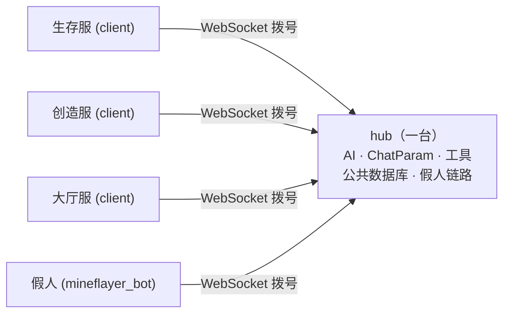

<div align="center">

# 跨服连接

[English](../en_us/cross-server.md)  |  简体中文  |  [繁體中文](../zh_tw/cross-server.md)

[返回 README](../../README.zh-CN.md)

</div>

GamesAI 支持把多台 MCDR 实例组成一个**集群**：它们共用同一个 AI、同一份对话历史、同一份公共数据库和同一套工具。本文说明它的角色判定、协议、命令分级与排障。

## 它是什么



- **hub**：唯一监听端口的实例，持有全部"有状态"的东西。玩家在任意实例上敲 `!!ask`，AI 请求、历史、工具执行都发生在 hub。
- **client**：接入 hub 的实例，只负责把玩家的命令转过去、把 hub 的输出显示给玩家。它本机不需要 API Key。
- **local**：跨服不可用时（见下）的独立模式，本机功能与从前完全一致。

一个集群只有 hub 需要对外开放端口，客户端**主动拨号**，所以客户端所在机器不必暴露任何端口。

**对话存在哪里**:`!!ask` 属于 server 类命令,因此每条对话(每个 `ChatParam`)都建立在 **hub** 上,并存进 hub 自己的 `config/games_ai/database/public_database.db`(`chat_history` 表)。客户端不持有任何对话 —— 这也是为什么把 hub 角色换到另一台机器时,必须把这个文件一起搬过去。一个用户的助手发给另一个用户对话的消息(`send_message_to_player_ai`)因此能覆盖整个集群,前提是它跑在 hub 上,且目标已经拥有对话。


## 角色是怎么定的

插件加载时在**后台线程**探测配置里的 `websocket.uri`（探测不会阻塞 MCDR 加载），规则按顺序如下：

|情况|结果|
|---|---|
|`force_server: true` 且端口空闲|**server**（本机监听这个 uri）|
|`force_server: true` 但端口被占|报错，退回 **local**|
|`uri` 能连上，且对端握手确认是 GamesAI|**client**（接入对端）|
|`uri` 能连上，但对面**不是** GamesAI|**local**（跨服整体停用，不抢端口、不转发命令）|
|`uri` 连不上，端口空闲|**server**|
|`uri` 连不上，但端口被占|**local**|
|`uri` 不是合法的地址 / 为空|**local**|
|`uri` 是 `wss://`|先探测，所以对端有 GamesAI hub 时是 **client**；探测不到才是 **local** —— 本插件**从不监听 TLS**，hub 必须用 `ws://`（TLS 由隧道/反向代理终止）|

判定结果会打一条日志，形如：

```
[GamesAI] cross-server role: server (nothing answered at ws://10.0.0.1:8765 and ws://10.0.0.1:8765 is free)
```

**身份**：客户端用 `websocket.name` 注册，留空时按**实例目录**派生（`<目录名>-<路径哈希前 6 位>`，如 `survival-9f31ab`）—— 同机两个实例因此天然不同名，改机器名也不影响注册。同名后到者仍会顶掉先到者（旧连接收到关闭码 `4003` 并带着原因退出），而且 hub **不会**给一个已经注册过的名字再签发 token：那会把在线的节点顶下线（`4001`，不可重试），要刻意替换请用 `!!gamesai node rotate <name>`。

**local 模式不是"什么都没有"**：它仍会在 `127.0.0.1` 上随机端口起一个只服务本机 peer 的回环 hub，让假人（见第 6 节）在 server、client、local 三种模式下都能接入。唯一的例外是 `websocket.uri` 为空：那时跨服整体停用，假人也没有可连的地址。


## 配置

```json
{
    "websocket": {
        "uri": "ws://10.0.0.1:8765",
        "force_server": false,
        "allow_app_id": [],
        "name": "",
        "token_ttl_hours": -1,
        "auto_enroll": true,
        "identity_file": ""
    }
}
```

|键|说明|
|---|---|
|`uri`|默认 `ws://127.0.0.1:8080`。集群地址。hub 用它作为监听地址（**按 uri 里的 host 严格绑定**，所以想被别的机器连上就要写 `ws://0.0.0.0:8765` 或本机内网 IP）；客户端用它作为连接目标。|
|`force_server`|默认 `false`；跳过探测，强制做 hub。|
|`allow_app_id`|字符串列表（默认 `[]`）。额外允许哪些握手 ID 接入本 hub，用于让你自己的服务连进来而不被 `4005` 拒绝。|
|`token_ttl_hours`|默认 `-1`。签发给节点的 token 有效期（小时）；`-1` 为永久。|
|`name`|默认 `""`。本实例在集群里的名字；留空时按**实例目录**派生：`<实例目录名>-<路径哈希前 6 位>`（如 `survival-9f31ab`），同机多实例因此不会撞名，改机器名也不受影响。|
|`auto_enroll`|默认 `true`。没有身份时向 hub 申请注册本实例。|
|`identity_file`|默认 `""`。覆盖身份文件路径（默认 `config/games_ai/cross_server/identity.json`）；相对路径按原样使用。|

每个实例使用**自己**的 token 完成认证：先注册、再由 hub 签发、最后在 node 上领取。详见下面的注册章节。

从旧版本升级时，旧的 `mineflayer_bot.websocket.url` 会自动迁移到 `websocket.uri` 并删除旧块，无需手动改配置。


## 协议

一帧一个 JSON 文本对象。

|帧|方向|载荷|
|---|---|---|
|`hello`|客户端 → hub|`type, app, protocol, server, token, version, features[], enroll`（探测帧额外带 `probe: true`；`enroll` 为 true 表示该实例没有 token 并要求注册）|
|`hello_ack`|hub → 客户端|`type, app, protocol, hub, peers[], you, expires_in`（`you` 是 hub 登记的名字，`expires_in` 是 token 有效期）|
|`enroll_pending`|hub → 客户端|`type, protocol, hub, name, requests, refused, message`（在注册请求被 `4007` 关闭之前发送）|
|`message`|双向|`type, request_id, source, target, action, message, data{}`|
|`reply`|双向|`type, request_id, source, target, ok, message, data{}, error`|
|`event`|双向|同 `message`，**永不应答**|

要点：

- `app` 必须是 `"games_ai_mcdr"`（`mineflayer_bot`，或 `websocket.allow_app_id` 里列出的 ID），`protocol` 必须一致 —— 两者一起才是 hub 判定"对端是不是 GamesAI"的唯一依据。
- `version` 与 `features[]` 是**信息性字段**：本实例跑的插件版本，以及它认得哪些可选能力（目前是 `update_order`）。两者都不做校验 —— 旧版本实例干脆不发这两个字段，hub 会把"没发"当成"不能对它下指令"，而不是当成协议错误。线上协议号仍是 1，所以半升级状态的集群照常通信。
- **hub 无条件覆写 `source`** 为发送方的注册名，所以对端无法冒充别的实例。
- `target`：某个名字 = 只投递给它；`"*"` = 除发送者外的所有节点；空/缺省/hub 自己 = 由 hub 本地处理。
- 每个 `message` 恰好回一个 `reply`，按 `request_id` 找回；`event` 不回。目标不存在时 hub **立即**回错误，不会让发送方干等到超时。
- 探测帧（`probe`）只被回答、**不被登记**，所以启动探测不会污染在线名单。
- **单帧上限 1 MiB**：超限的帧不会被发出去 —— `reply` 会变成一条简短的诚实错误，流式 `command_reply` 会变成一行诚实说明，其他帧则被丢弃并在发送方日志里记一条 warning —— 所以一条过大的输出不会把链路一起打断。
- **对端断链时，等它回答的调用会被立即唤醒**，收到的是"结果未知、不要重试"，而不是干等到超时。

## 握手 ID

`hello` 里的 `app` 字段就是握手 ID，它说明**连进来的是什么**，hub 按它自动适配：

|`app`|谁在连|hub 怎么对待|
|---|---|---|
|`games_ai_mcdr`|另一台 GamesAI 实例|参与命令路由、集群广播与在线名单|
|`mineflayer_bot`|Mineflayer 假人|只应答 `bot_action`，**不会**收到集群广播；它发来的 `command` / `command_cluster` / `exec_cluster` / `tool_call` / `event` 一律被 hub 拒绝并记 warning|
|`allow_app_id` 里列出的|你自己的服务|按通用 peer 处理：定向 `message`/`reply` 可用，也被当作可信成员参与集群广播|

`hello_ack` 里的 `app` **永远是 hub 自己的标识 `games_ai_mcdr`**，另外带一个 `you` 字段告诉对端"你被认成了什么"。`app` 既不在上表、也不在 `allow_app_id` 里的连接，会被 `4005` 关闭。

`allow_app_id` 只放宽 hub 的**接收**校验：hub 不会为这些 ID 做任何专项适配（它们就是普通 peer），我们自己的客户端也仍然声明 `games_ai_mcdr`、仍然要求对端 hub 是 `games_ai_mcdr`。列入其中的服务会被**完全信任**（可以像 GamesAI 实例一样触发命令执行），所以只填你自己控制的服务。

GamesAI-Java 将来会使用 `games_ai_java`；在它成为内置身份之前，你可以把该 ID 填进 `allow_app_id` 先行接入。

### 注册（每个实例一份 token）

集群不再使用共享口令，每个实例持有**自己**的 token：

1. **请求注册**：没有 token 的实例启动后会向 hub 发一次注册请求（除非 `websocket.auto_enroll` 为 `false`）。hub 把它的名字记入等待列表，然后用 `4007` 断开 —— 这个码**不可重试**（没有 token 就永远注册不上，反复重连毫无意义）。该实例保持 local 模式：功能可用，但只服务本机；
2. **hub 签发**：操作者在 hub 上 `!!gamesai node pending` 看到等待中的名字，再 `!!gamesai node token <名字>` —— **只有正在等待的名字可以签发**。hub 只保存 `sha256` 哈希，明文 token 只在这一条回复里出现一次；
3. **node 领取**：到那台实例上 `!!gamesai node claim <token>`，它把 token 写入 `config/games_ai/cross_server/identity.json` 并立即重连，成为正式成员。

链路的运行时状态都放在 `config/games_ai/cross_server/` 里：`identity.json`（本实例的 token，节点侧）、`nodes.json`（hub 的节点表：每台已入网节点一条哈希，外加等待中的注册请求）、`role.json`（本实例上次加载时的角色）。在这个目录出现之前就已经装好的实例会在首次使用时**自动迁移**，因此不需要重新 claim；`websocket.identity_file` 仍然可以完全覆盖身份文件的路径。

|命令|位置|作用|
|---|---|---|
|`!!gamesai node pending`|hub|列出等待注册的名字（名字、app、来源 IP、等待时长）|
|`!!gamesai node token <名字>`|hub|为该名字签发 token 并显示一次|
|`!!gamesai node list`|hub|已注册节点：名字、app、**版本**、签发时间、有效期、最近来源与时间、指纹|
|`!!gamesai node revoke <名字>`|hub|撤销（该实例下次连接得到 `4001`）|
|`!!gamesai node rotate <名字>`|hub|换发新 token（旧的立即失效）|
|`!!gamesai node claim <token>`|node|领取/更新本机身份并重连|
|`!!gamesai node status`|任意|按角色给答案：hub 报本机名、监听地址、已注册节点数与在线数；client 报 hub 名字、是否已入网、指纹与剩余有效期；local 报角色、是否已入网与指纹，并说明为什么没有链路|
|`!!gamesai node forget`|node|丢弃本机身份并断开（怀疑泄漏或换 hub 时）|

**有效期**由 hub 的 `websocket.token_ttl_hours` 决定（单位小时，默认 `-1` 永久），签发时固化，**只在握手时校验**，不会中断正在进行的连接。主从同机时保持 `-1` 即可；跨主机建议设一个值，这样身份文件万一泄漏也只在一段时间内可用。

**过期与撤销**：过期得到 `4008`，被撤销或未知得到 `4001`，两者都**不可重试** —— 在 hub 上 `node rotate`（或 `node token`）后重新 `claim` 即可。

**注册请求的限额**（`pending` 是唯一对外开着的表）：同一个地址每分钟最多 10 次**新名字**请求，等待列表最多 32 条，超过 7 天没人处理的请求会自动消失（`!!gamesai node pending` 里能看到的年龄）。同一个名字重复请求不受限、也不会重复写盘；被拒绝的请求不写入任何东西，只记一条 warning。

**机器人不需要人工**：`mineflayer_bot` 由 hub 自动签发 token（仅限来自本机回环、或来自已注册节点所在机器的请求），签发它的 hub 会把 token 写进自己那台机器人的 JS 配置；机器人跑在别的实例旁边时，会在握手中拿到 token 并只在本次会话的内存里保存。**机器人身份只用于应答 `bot_action`**：它发来的 `command`、`command_cluster`、`exec_cluster`、`tool_call` 与 `event` 帧会被 hub 直接拒绝并记一条 warning。

**安全边界**：日志、`node list`、`node status` 只显示 token 指纹，`!!gamesai config get` 不回显 token，除了 `node token` / `node rotate` 那一条回复（MCDR 会把它写进 hub 的控制台日志）之外，明文只存在于 node 的身份文件里。链路未加密，因此**跨主机部署请用内网穿透/隧道**把链路包起来（主从同机没有这个问题）；注意隧道/反向代理会让 hub 把所有来源都看成回环地址，所以**能到达端口就等于能拿到机器人身份**——因此机器人身份只能应答 `bot_action`，它发来的命令、工具调用与事件帧一律被 hub 拒绝（见下）。

关闭码：

|码|含义|
|---|---|
|`4000`|首帧不是合法的 hello|
|`4001`|token 不匹配|
|`4002`|没带服务器名|
|`4003`|名字被更新的连接顶掉|
|`4004`|协议版本不一致|
|`4005`|对端不是 GamesAI 实例|
|`4007`|需要注册：本实例没有 token 且没有申请注册（或 hub 拒绝了这次请求）|
|`4008`|注册 token 已过期|

客户端遇到 `4001/4002/4003/4004/4005/4007/4008` 会**放弃重试**并打出原因；其他情况（hub 重启、网络抖动）按指数退避重连。


## 命令怎么走

|类|行为|命令|
|---|---|---|
|**A**|交给 hub 执行|`!!ask`（含 `-n/-f/switch/stop/compact/context`）、`!!data` 全部子命令、`!!gamesai clear [name]`、`!!gamesai check`、`!!gamesai speedtest`、`!!gamesai config get/set`、`!!aibot join/leave/set`|
|**B**|在输入的那台执行|各命令的帮助文本|
|**C**|集群广播（hub + 所有客户端各自执行）|`!!gamesai clearall`、`!!gamesai reload`、`!!gamesai debug`、`!!gamesai debug thread`|

- **A 类的回复不带任何前缀**：`!!ask`、`!!data` 这些命令是交给 hub 执行、hub 在**替你回答**，所以你在客户端看到的每一行都跟本机命令一样干净（不出现 `[hub 名字]`）。
- **C 类的输出**：只有**集群广播**才会标注来源 —— 发起方自己那台不加前缀，其他实例加 `[实例名]`，例如
  `[GamesAI] 已重新加载` / `[survival-9f31ab] 已重新加载` / `[creative-4c1e07] 已重新加载`。
- **内部调用永不转发**：没有 `Info` 的调用（例如插件自己调 `server.execute_command()`）留在本地执行，否则 `reload` 会在集群里来回弹。
- **`!!gamesai node …` 在输入的那台执行**：入网命令属于持有身份的那台实例（或持有节点表的 hub），因此它们不参与路由 —— 不转交 hub，也不向集群广播。
- **权限**：远端玩家取 `min(客户端上报等级, hub 侧 permission.yml)`；hub 不认识这个名字就是 **0**。远端**控制台**恒为 **4**（能坐在那台机器前敲控制台的人本来就有那台机器的完全控制权）。
- **`!!gamesai reload` 不动链路**：它会重新读取配置并重启机器人，但跨服链路照常在跑，所以还在回传的 `!!ask` 会继续收到输出。`websocket.*` 的改动只在链路建立时被读取，所以这类改动要用 `!!MCDR plugin reload games_ai` 生效（或者用 `!!gamesai node claim` / `node forget`，它们会重建链路）。重载的完整步骤见[热重载](hot-reload.md)。
- **`!!gamesai check` 属于 A 类**：检查插件更新是 hub 的决定，hub 随后协调整个集群（见下文"集群更新"）。客户端输入它会转交 hub；客户端自己从不检查。


## 集群更新

一次更新就是**一轮（round）**，轮内顺序就是这件事的全部意义：

1. **hub** 先从插件 catalogue 解析出发布版本，并且**先**把产物下载、校验完 —— 自己都装不上的 hub 没有资格命令节点去装；
2. hub 向每台在线节点下指令（`plugin_update`，立即应答），然后**阻塞等待**。每台节点自己去取那份被钉住的产物 —— 先试 GitHub release 资产地址，再用 `https://ghfast.top/<该地址>` 镜像；只有尺寸、sha256 **以及**归档内的插件 id 与版本全部对上才接受；随后回报 `staged`，再替换自己的文件；
3. hub 等到每台节点要么 `staged`、要么失败，然后继续等到它**在 `hello` 里报出新版本**。这个"重连回来"才是权威的完成信号 —— `staged` 只说明磁盘上的字节校验通过；
4. 直到这时 hub 才替换自己的文件。之前会先告诉玩家；链路会断几秒，节点自己会重连回来。

**为什么 hub 必须最后。** 节点的跨服角色是**每次插件加载只判定一次**的，所以如果在 hub 不在时加载，它会发现 hub 的地址空着并抢占端口；真正的 hub 回来后会看到一个 GamesAI hub 在应答，于是变成**对方的客户端** —— 两个角色就此互换并稳定下来。现在有两道防线：上面的顺序，以及"**已入网实例永不接管 hub 角色**"（见下文"角色记忆与宽限期"）。

**节点侧的规矩。** 只接受 `source` 是本机所属 hub 的指令；地址必须是本插件自己的 GitHub release 资产；版本与自己当前相同则视为无需处理并回报"已就绪"；上一轮还在跑时再来的指令会被拒绝。运行旧版本的实例从未在 `hello` 里声明 `update_order` 能力，所以 hub 根本不会把这条指令发给它：它会被记为"不支持更新指令"，需要手工升级一次。

**错过一轮的节点**（当时离线，或下载失败）会在重连时被补上：hub 从它的 `hello` 里看到版本偏旧，就命令**那一台**节点安装 hub 自己正在跑的版本。hub 不会重装自己，这种补课每分钟最多一轮。如果 hub 跑的版本从未发布到 catalogue，就无法分发 —— 日志会说明，那台节点只能手工安装。

**刻意没有 `!!MCDR plugin install` 兜底。** 任何一步失败，这一轮就结束：玩家收到一行汇总，日志里写明原因（下载不通、sha256 不符、文件被 Windows 锁住、加载失败已回滚），下一次检查就是下一轮。替代兜底的是"替换之前先全部校验"加上旧归档的 `.bak` 副本 —— 新文件起不来时会把旧文件恢复并重新加载。运维随时可以手工执行 `!!MCDR plugin install -U -y games_ai`；插件自己永远不会执行这条命令。

**从旧版本升级。** 旧构建听不懂这条指令：旧节点从未在 `hello` 里声明 `update_order` 能力，hub 因此根本不会把指令发给它，只把它记为"不支持更新指令"。这种实例需要手工升级一次（`!!MCDR plugin install -U -y games_ai`），或者等它自己旧版里的 24 小时检查把新版本装上 —— 之后它就是一个只服从 hub 的客户端。


## 假人（Mineflayer bot）如何接入

机器人**不自己监听端口**，而是作为一个**客户端**接入集群：

- 注册名 = 机器人的 Minecraft 用户名（在 `mineflayer_bot.bot.username` 配置）。
- 地址：hub 模式连本机 hub；client 模式连配置里的那个 uri（即远端 hub）；local 模式连本机回环 hub。
- 插件发给它的动作名为 `bot_action`，回复沿用原来的 `{status, data}` 结构，所以所有 bot 工具与自治控制器的行为与以前完全一致。
- 因此启动顺序是**先定角色、再写机器人配置并拉起进程**（机器人连哪个地址取决于本机角色）。


## 回传的富文本

跨服回传使用 **MCDR 自己的 JSON 文本对象**（`RTextBase.to_json_object()` / `from_json_object()`），没有自造格式，因此这些都能原样跨服：

- 颜色（`color`）与粗体/斜体/下划线/删除线；
- hover 文本（含多行）；
- 点击动作四种全部保留：`run_command`、`suggest_command`、`copy_to_clipboard`、`open_url`；
- 多段列表（`RTextList`）与嵌套。

所以在客户端上，`!!data read` 的"写入/复制"按钮、`!!ask` 的彩色前缀与 hover 提示都和本机一样可用。

> [!NOTE]
> `run_command` 意味着**远端 hub 能让你的玩家点到"执行命令"的按钮**。集群里的每一台都必须是你能信任的。


## 工具作用域

AI 与工具都在 **hub** 上运行，但有一部分工具只能在**玩家所在的服务器**上执行：玩家坐标、在线名单、本服的实体与假人，问的都是"我这里"，而 hub 不是"我这里"。

机制分两步：

1. **每次请求上传**：发起方把自己**能在本机执行**的工具 schema 随命令一起上传给 hub；
2. **按标签分派**：每个工具注册时带一个 `execute_in_hub` 标志（默认 `false`）。为 `true` 的在 hub 上执行；为 `false` 且请求来自其它实例时，hub 把这次调用**回传给发起方**，由它在本机执行并把结果送回。

所以模型看到的工具是"hub 的 hub 工具 ∪ 发起方上传的工具"，**两边都没有的工具模型根本看不到**，不会调用一个不存在的工具。

自己写工具时这个标志怎么用，写在[tools.md](tools.md)里。

|执行侧|工具|
|---|---|
|hub|数据的读写增删、技能的增删改查、自定义工具文件、插件重载、计时器、机器人启停与机器人动作、自主委托|
|发起方（本机）|玩家坐标、在线玩家名单、计算器、物品计算|

两条边界：权限由**发起方用自己的 `permission.yml` 重新裁定**（hub 上报的等级只是输入）；回传调用**不自动重试**，超时会明确告诉模型"结果未知"，因为对方可能已经执行成功了。

### 工具定义不会在各实例之间同步

`config/games_ai/tools/tools.py` 是**每台实例各自一份**，插件之间**没有任何同步机制**：

- 写工具的那几个工具（`read_custom_tools`、`modify_custom_tools`、`append_custom_tools`、`reload_plugin`）属于 hub 侧，所以 **AI 只会写 hub 的那一份**；从 node 提问也一样，落点仍然是 hub；
- 想让几台实例都有同一个工具，只能**人工把 hub 的 `tools/tools.py` 复制到各 node 的 `config/games_ai/tools/tools.py`**，复制后在那台执行 `!!gamesai reload`；
- **node 上的 `tools.py` 只能人工修改**：GamesAI 没有写别的实例文件的通道，也不该让模型隔着链路往别的机器写代码；
- 因此 hub 上写出来的工具默认（没标 `execute_in_hub=True`）只对**在 hub 上提问的玩家**可见。想让每台实例的玩家都能用，要么标 `execute_in_hub=True`（在 hub 上执行，碰不到玩家的世界），要么把代码复制到各 node（那时它在玩家所在实例执行）。

## 角色记忆与宽限期

角色**每次加载只判定一次**，所以判定时刻的偶然情况会一直保留到下次重载。同机双实例尤其危险：两边的 `uri` 指向同一个**本机可以绑定的**地址，同时重载时先加载的那台会抢到端口成为 hub，后加载的那台反过来变成它的 client —— 角色就此**互换并稳定下来**。

现在的做法：

- **记住上次的角色**：判定结果写入 `config/games_ai/cross_server/role.json`（运行时文件，不必手改）。曾经是 client 的实例在重载后会**等待 hub 回来**，而不是去抢端口；
- **宽限期**：默认 15 秒，每 1.5 秒重探一次，期间日志会说明在等谁；
- **本机绑不上的地址永不判 hub**：指向别的机器的 `uri` 只可能是"被拨号的对象"，直接按 client / local 处理；
- **hub 自身重载仍然立即判定**（它的端口是空的），启动延迟不变；
- **宽限期内 hub 始终不回来**：**没有身份**的实例才会**接管**成为 hub，而不是各自为政 —— 集群宁可变更中心，也不要静默分裂。
- **已入网实例永不接管 hub 角色**：当它持有节点 token、且自己的角色记忆不是 `server` 时，不会去抢空闲端口：它始终留在 client，持续重试那个地址，链路断开期间拒绝 hub 类命令（就是那句"跨服连接不可用"）。想在这台机器上重建 hub，先执行 `!!gamesai node forget` —— 那会丢掉 token，下次加载就又可以监听这个地址了。正是这条规则挡住了"提前升级完的节点"以及"hub 不在时被人手工重启的节点"把两个角色永久互换。`force_server: true` 仍然优先于这条规则：它是运维的明确选择。
- **当 hub 的地址不是本机能绑定的地址**（常见部署:hub 在另一台机器）且加载时它没有应答，该实例会落到 **local** 模式。它本来就不可能抢到那个端口，所以不存在角色互换 —— 但此时 hub 类命令会带着**本实例自己的状态和 API Key** 就地执行，日志会逐条说明（`running '!!ask' here ... run !!gamesai node status`）。请检查 hub，等它恢复后重载本实例。

## 排障

|现象|原因与处理|
|---|---|
|日志里 `cross-server role: local (... is occupied by something that is not a GamesAI hub)`|那个地址被别的服务占了。换一个 `websocket.uri` 端口，或把占用它的服务挪走。|
|日志里 `cross-server role: local (... is already occupied)` 且开了 `force_server`|端口被占，绑不上。同上。|
|客户端一直重连|看 hub 是否在跑、`uri` 是否可达；`4003` 说明两台实例用了同一个 `websocket.name`（给其中一台改名）；`4001` 说明它的 token 已被顶掉（用 `node rotate` 重新签发，再 `node claim`）。|
|命令没反应，提示"跨服连接不可用"|本机被判定为 client 但链路当前断开；等自动重连，或检查 hub。|
|玩家明明有权限却被拒|hub 侧的 `permission.yml` 里没有这个玩家名（远端权限取 `min()`，查不到就是 0）。|
|客户端一直连不上，日志说需要注册或 token 已过期|该实例没有 token，或 token 已被撤销/过期。在 hub 上执行 `!!gamesai node pending`，再执行 `!!gamesai node token <名字>`；到那台实例上执行 `!!gamesai node claim <token>`。|
|机器人一直不上线|看它的日志：它连的是插件写进自己配置里的地址（server/client 模式是 `websocket.uri`，local 模式是本机回环 hub），hub 没起来或地址不对时会按 `reconnect_interval` 重试。|
|某台节点从不自己更新，日志说"由 hub 决定更新"|该实例是跨服客户端：客户端完全不跑更新检查。执行 `!!gamesai check`（客户端会转交 hub），或等 hub 的那一轮。|
|更新失败了，也没有别的尝试|这是刻意的 —— 没有 `!!MCDR plugin install` 兜底，一轮失败就结束。看日志里的原因（下载不通、sha256 不符、文件被锁、加载失败已回滚），再执行一次 `!!gamesai check`，或手工安装。|
|日志说"本实例已登记为节点,不会接管 hub 角色"|本实例加载时 hub 没有应答。它会一直重试。如果 hub 已经彻底没了，在本实例执行 `!!gamesai node forget` 再重载，就能在这里重建 hub。|
|轮次汇总里某台节点被记为"不支持更新指令"|那台实例跑的还是此功能之前的版本。手工升级它一次（`!!MCDR plugin install -U -y games_ai`），之后它就会服从 hub。|
|在客户端输入 `!!gamesai check`：能看到"正在检查"，但看不到这一轮的过程|检查本身与结果（有新版本 / 无新版本）会回传给输入命令的人;而这一轮的过程 —— 下单、每台节点的结果、汇总 —— 在 hub 上执行并打印在 hub 那边（hub 也会用聊天栏告知玩家）。|
|实例明明已入网，日志却说某条 hub 类命令"ran here"（就地执行）|hub 的地址不是本机能绑定的地址，且加载时它没有应答，于是本实例落到 local 模式（见上文"角色记忆与宽限期"）。请检查 hub，恢复后重载本实例。|
|更新失败后插件旁边留了 `.bak`（有时还有 `.part`）|这是刻意的:`.bak` 是上一版归档，留作你手工回滚的副本;`.part` 是一次没下完的尝试。两者都不是插件文件（MCDR 会忽略它们），确认不再需要副本后删掉即可。|

调试建议：`!!gamesai debug`（C 类）会把各实例的调试日志打开；单个实例的角色与在线名单分别打在各实例自己的日志里。
