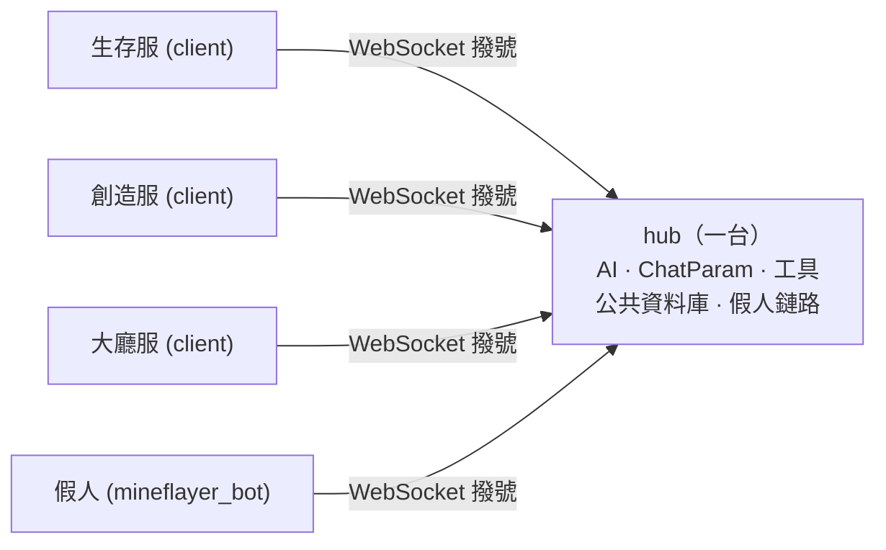

<div align="center">

# 跨服連線

[English](../en_us/cross-server.md)  |  [简体中文](../zh_cn/cross-server.md)  |  繁體中文

[返回 README](../../README.zh-TW.md)

</div>

GamesAI 支援把多台 MCDR 實例組成一個**叢集**：它們共用同一個 AI、同一份對話歷史、同一份公共資料庫與同一套工具。本文說明角色判定、協定、指令分級與排障。

## 它是什麼



- **hub**：唯一監聽連接埠的實例，持有全部「有狀態」的東西。玩家在任意實例上敲 `!!ask`，AI 請求、歷史、工具執行都發生在 hub。
- **client**：接入 hub 的實例，只負責把玩家的指令轉過去、把 hub 的輸出顯示給玩家。它本機不需要 API Key。
- **local**：跨服不可用時（見下）的獨立模式，本機功能與從前完全一致。

一個叢集只有 hub 需要對外開放連接埠，客戶端**主動撥號**，所以客戶端所在機器不必暴露任何連接埠。

**對話存在哪裡**：`!!ask` 屬於 server 類指令，因此每條對話（每個 `ChatParam`）都建立在 **hub** 上，並存進 hub 自己的 `config/games_ai/database/public_database.db`（`chat_history` 表）。客戶端不持有任何對話 —— 這也是為什麼把 hub 角色換到另一台機器時，必須把這個檔案一起搬過去。一個使用者的助手發給另一個使用者對話的訊息（`send_message_to_player_ai`）因此能覆蓋整個叢集，前提是它跑在 hub 上，且目標已經擁有對話。


## 角色是怎麼定的

外掛載入時在**背景執行緒**探測設定裡的 `websocket.uri`（探測不會阻塞 MCDR 載入），規則依序如下：

|情況|結果|
|---|---|
|`force_server: true` 且連接埠空閒|**server**（本機監聽這個 uri）|
|`force_server: true` 但連接埠被佔|報錯，退回 **local**|
|`uri` 能連上，且對端握手確認是 GamesAI|**client**（接入對端）|
|`uri` 能連上，但對面**不是** GamesAI|**local**（跨服整體停用，不搶連接埠、不轉發指令）|
|`uri` 連不上，連接埠空閒|**server**|
|`uri` 連不上，但連接埠被佔|**local**|
|`uri` 不是合法的位址 / 為空|**local**|
|`uri` 是 `wss://`|先探測，所以對端有 GamesAI hub 時是 **client**；探測不到才是 **local** —— 本外掛**從不監聽 TLS**，hub 必須用 `ws://`（TLS 由隧道/反向代理終止）|

判定結果會打一條日誌，形如：

```
[GamesAI] cross-server role: server (nothing answered at ws://10.0.0.1:8765 and ws://10.0.0.1:8765 is free)
```

**身分**：客戶端用 `websocket.name` 註冊，留空時按**實例目錄**派生（`<目錄名>-<路徑雜湊前 6 位>`，如 `survival-9f31ab`）—— 同機兩個實例因此天然不同名，改機器名也不影響註冊。同名後到者仍會頂掉先到者（舊連線收到關閉碼 `4003` 並帶著原因結束），而且 hub **不會**為已經註冊過的名字再簽發 token：那會把在線的節點頂下線（`4001`，不可重試），要刻意替換請用 `!!gamesai node rotate <name>`。

**local 模式不是「什麼都沒有」**：它仍會在 `127.0.0.1` 上隨機連接埠起一個只服務本機 peer 的回環 hub，讓假人（見第 6 節）在 server、client、local 三種模式下都能接入。唯一的例外是 `websocket.uri` 為空：那時跨服整體停用，假人也沒有可連的位址。


## 設定

```json
{
    "websocket": {
        "uri": "ws://10.0.0.1:8765",
        "force_server": false,
        "allow_app_id": [],
        "name": "",
        "token_ttl_hours": -1,
        "auto_enroll": true,
        "identity_file": ""
    }
}
```

|鍵|說明|
|---|---|
|`uri`|預設 `ws://127.0.0.1:8080`。叢集位址。hub 用它作為監聽位址（**嚴格按 uri 裡的 host 綁定**，所以想被別的機器連上就要寫 `ws://0.0.0.0:8765` 或本機內網 IP）；客戶端用它作為連線目標。|
|`force_server`|預設 `false`；跳過探測，強制當 hub。|
|`allow_app_id`|字串列表（預設 `[]`）。額外允許哪些握手 ID 接入本 hub，用於讓你自己的服務連進來而不被 `4005` 拒絕。|
|`token_ttl_hours`|預設 `-1`。簽發給節點的 token 有效期（小時）；`-1` 為永久。|
|`name`|預設 `""`。本實例在叢集裡的名字；留空時按**實例目錄**派生：`<實例目錄名>-<路徑雜湊前 6 位>`（如 `survival-9f31ab`），同機多實例因此不會撞名，改機器名也不受影響。|
|`auto_enroll`|預設 `true`。沒有身分時向 hub 申請註冊本實例。|
|`identity_file`|預設 `""`。覆寫身分檔案路徑（預設 `config/games_ai/cross_server/identity.json`）；相對路徑按原樣使用。|

每個實例使用**自己**的 token 完成認證：先註冊、再由 hub 簽發、最後在 node 上領取。詳見下面的註冊章節。

從舊版本升級時，舊的 `mineflayer_bot.websocket.url` 會自動遷移到 `websocket.uri` 並刪除舊區塊，無需手動改設定。


## 協定

一幀一個 JSON 文字物件。

|幀|方向|載荷|
|---|---|---|
|`hello`|客戶端 → hub|`type, app, protocol, server, token, version, features[], enroll`（探測幀額外帶 `probe: true`；`enroll` 為 true 表示該實例沒有 token 並要求註冊）|
|`hello_ack`|hub → 客戶端|`type, app, protocol, hub, peers[], you, expires_in`（`you` 是 hub 登記的名字，`expires_in` 是 token 有效期）|
|`enroll_pending`|hub → 客戶端|`type, protocol, hub, name, requests, refused, message`（在註冊請求被 `4007` 關閉之前發送）|
|`message`|雙向|`type, request_id, source, target, action, message, data{}`|
|`reply`|雙向|`type, request_id, source, target, ok, message, data{}, error`|
|`event`|雙向|同 `message`，**永不應答**|

要點：

- `app` 必須是 `"games_ai_mcdr"`（`mineflayer_bot`，或 `websocket.allow_app_id` 裡列出的 ID），`protocol` 必須一致 —— 兩者一起才是 hub 判定「對端是不是 GamesAI」的唯一依據。
- `version` 與 `features[]` 是**資訊性欄位**：本實例跑的外掛版本，以及它認得哪些可選能力（目前是 `update_order`）。兩者都不做校驗 —— 舊版本實例乾脆不送這兩個欄位，hub 會把「沒送」當成「不能對它下指令」，而不是當成協定錯誤。線上協定號仍是 1，所以半升級狀態的叢集照常通訊。
- **hub 無條件覆寫 `source`** 為發送方的註冊名，所以對端無法冒充別的實例。
- `target`：某個名字 = 只投遞給它；`"*"` = 除發送者外的所有節點；空/缺省/hub 自己 = 由 hub 本地處理。
- 每個 `message` 恰好回一個 `reply`，按 `request_id` 找回；`event` 不回。目標不存在時 hub **立即**回錯誤，不會讓發送方乾等到逾時。
- 探測幀（`probe`）只被回答、**不被登記**，所以啟動探測不會污染線上名單。
- **單幀上限 1 MiB**：超限的幀不會被發出去 —— `reply` 會變成一條簡短的誠實錯誤，串流 `command_reply` 會變成一行誠實說明，其他幀則被丟棄並在發送方日誌裡記一條 warning —— 所以一條過大的輸出不會把鏈路一起打斷。
- **對端斷鏈時，等它回答的呼叫會被立即喚醒**，收到的是「結果未知、不要重試」，而不是乾等到逾時。

## 握手 ID

`hello` 裡的 `app` 欄位就是握手 ID，它說明**連進來的是什麼**，hub 依它自動適配：

|`app`|誰在連|hub 怎麼對待|
|---|---|---|
|`games_ai_mcdr`|另一台 GamesAI 實例|參與指令路由、叢集廣播與線上名單|
|`mineflayer_bot`|Mineflayer 假人|只應答 `bot_action`，**不會**收到叢集廣播；它發來的 `command` / `command_cluster` / `exec_cluster` / `tool_call` / `event` 一律被 hub 拒絕並記 warning|
|`allow_app_id` 裡列出的|你自己的服務|按通用 peer 處理：定向 `message`/`reply` 可用，也被當作可信成員參與叢集廣播|

`hello_ack` 裡的 `app` **永遠是 hub 自己的標識 `games_ai_mcdr`**，另外帶一個 `you` 欄位告訴對端「你被認成了什麼」。`app` 既不在上表、也不在 `allow_app_id` 裡的連線，會被 `4005` 關閉。

`allow_app_id` 只放寬 hub 的**接收**校驗：hub 不會為這些 ID 做任何專項適配（它們就是普通 peer），我們自己的客戶端也仍然宣告 `games_ai_mcdr`、仍然要求對端 hub 是 `games_ai_mcdr`。列入其中的服務會被**完全信任**（可以像 GamesAI 實例一樣觸發指令執行），所以只填你自己控制的服務。

GamesAI-Java 將來會使用 `games_ai_java`；在它成為內置身分之前，你可以把該 ID 填進 `allow_app_id` 先行接入。

### 註冊（每個實例一份 token）

叢集不再使用共享口令，每個實例持有**自己**的 token：

1. **請求註冊**：沒有 token 的實例啟動後會向 hub 發一次註冊請求（除非 `websocket.auto_enroll` 為 `false`）。hub 把它的名字記入等待清單，然後用 `4007` 斷開 —— 這個碼**不可重試**（沒有 token 就永遠註冊不上，反覆重連毫無意義）。該實例保持 local 模式：功能可用，但只服務本機；
2. **hub 簽發**：操作者在 hub 上 `!!gamesai node pending` 看到等待中的名字，再 `!!gamesai node token <名字>` —— **只有正在等待的名字可以簽發**。hub 只保存 `sha256` 雜湊，明文 token 只在這一條回覆裡出現一次；
3. **node 領取**：到那台實例上 `!!gamesai node claim <token>`，它把 token 寫入 `config/games_ai/cross_server/identity.json` 並立即重連，成為正式成員。

鏈路的執行期狀態都放在 `config/games_ai/cross_server/` 裡：`identity.json`（本實例的 token，節點側）、`nodes.json`（hub 的節點表：每台已入網節點一條雜湊，外加等待中的註冊請求）、`role.json`（本實例上次載入時的角色）。在這個目錄出現之前就已經裝好的實例會在首次使用時**自動遷移**，因此不需要重新 claim；`websocket.identity_file` 仍然可以完全覆寫身份檔案的路徑。

|命令|位置|作用|
|---|---|---|
|`!!gamesai node pending`|hub|列出等待註冊的名字（名字、app、來源 IP、等待時長）|
|`!!gamesai node token <名字>`|hub|為該名字簽發 token 並顯示一次|
|`!!gamesai node list`|hub|已註冊節點：名字、app、**版本**、簽發時間、有效期、最近來源與時間、指紋|
|`!!gamesai node revoke <名字>`|hub|撤銷（該實例下次連線得到 `4001`）|
|`!!gamesai node rotate <名字>`|hub|換發新 token（舊的立即失效）|
|`!!gamesai node claim <token>`|node|領取/更新本機身份並重連|
|`!!gamesai node status`|任意|按角色給答案：hub 報本機名、監聽位址、已註冊節點數與在線數；client 報 hub 名字、是否已入網、指紋與剩餘有效期；local 報角色、是否已入網與指紋，並說明為什麼沒有連線|
|`!!gamesai node forget`|node|丟棄本機身份並斷開（懷疑洩漏或換 hub 時）|

**有效期**由 hub 的 `websocket.token_ttl_hours` 決定（單位小時，預設 `-1` 永久），簽發時固化，**只在握手時校驗**，不會中斷正在進行的連線。主從同機時保持 `-1` 即可；跨主機建議設一個值，這樣身份檔案萬一洩漏也只在一段時間內可用。

**過期與撤銷**：過期得到 `4008`，被撤銷或未知得到 `4001`，兩者都**不可重試** —— 在 hub 上 `node rotate`（或 `node token`）後重新 `claim` 即可。

**註冊請求的限額**（`pending` 是唯一對外開著的表）：同一個位址每分鐘最多 10 次**新名字**請求，等待清單最多 32 條，超過 7 天沒人處理的請求會自動消失（`!!gamesai node pending` 裡能看到的年齡）。同一個名字重複請求不受限、也不會重複寫盤；被拒絕的請求不寫入任何東西，只記一條 warning。

**機器人不需要人工**：`mineflayer_bot` 由 hub 自動簽發 token（僅限來自主機回環、或來自已註冊節點所在機器的請求），簽發它的 hub 會把 token 寫進自己那台機器人的 JS 設定；機器人跑在別的實例旁邊時，會在握手中拿到 token 並只在本次工作階段的記憶體裡保存。**機器人身份只用於應答 `bot_action`**：它發來的 `command`、`command_cluster`、`exec_cluster`、`tool_call` 與 `event` 幀會被 hub 直接拒絕並記一條 warning。

**安全邊界**：日誌、`node list`、`node status` 只顯示 token 指紋，`!!gamesai config get` 不回顯 token，除了 `node token` / `node rotate` 那一條回覆（MCDR 會把它寫進 hub 的主控台日誌）之外，明文只存在於 node 的身份檔案裡。鏈路未加密，因此**跨主機部署請用內網穿透/隧道**把鏈路包起來（主從同機沒有這個問題）；注意隧道/反向代理會讓 hub 把所有來源都看成回環位址，所以**能到達連接埠就等於能拿到機器人身份**——因此機器人身份只能應答 `bot_action`，它發來的指令、工具呼叫與事件幀一律被 hub 拒絕（見下）。

關閉碼：

|碼|含義|
|---|---|
|`4000`|首幀不是合法的 hello|
|`4001`|token 不匹配|
|`4002`|沒帶伺服器名|
|`4003`|名字被更新的連線頂掉|
|`4004`|協定版本不一致|
|`4005`|對端不是 GamesAI 實例|
|`4007`|需要註冊：本實例沒有 token 且沒有申請註冊（或 hub 拒絕了這次請求）|
|`4008`|註冊 token 已過期|

客戶端遇到 `4001/4002/4003/4004/4005/4007/4008` 會**放棄重試**並打出原因；其他情況（hub 重啟、網路抖動）按指數退避重連。


## 指令怎麼走

|類|行為|指令|
|---|---|---|
|**A**|交給 hub 執行|`!!ask`（含 `-n/-f/switch/stop/compact/context`）、`!!data` 全部子指令、`!!gamesai clear [name]`、`!!gamesai check`、`!!gamesai speedtest`、`!!gamesai config get/set`、`!!aibot join/leave/set`|
|**B**|在輸入的那台執行|各指令的說明文字|
|**C**|叢集廣播（hub + 所有客戶端各自執行）|`!!gamesai clearall`、`!!gamesai reload`、`!!gamesai debug`、`!!gamesai debug thread`|

- **A 類的回覆不帶任何前綴**：`!!ask`、`!!data` 這些指令是交給 hub 執行、hub 在**替你回答**，所以你在客戶端看到的每一行都跟本機指令一樣乾淨（不出現 `[hub 名字]`）。
- **C 類的輸出**：只有**叢集廣播**才會標註來源 —— 發起方自己那台不加前綴，其他實例加 `[實例名]`，例如
  `[GamesAI] 已重新載入` / `[survival-9f31ab] 已重新載入` / `[creative-4c1e07] 已重新載入`。
- **內部呼叫永不轉發**：沒有 `Info` 的呼叫（例如外掛自己呼叫 `server.execute_command()`）留在本地執行，否則 `reload` 會在叢集裡來回彈。
- **`!!gamesai node …` 在輸入的那台執行**：入網指令屬於持有身分的那台實例（或持有節點表的 hub），因此它們不參與路由 —— 不轉交 hub，也不向叢集廣播。
- **權限**：遠端玩家取 `min(客戶端上報等級, hub 側 permission.yml)`；hub 不認識這個名字就是 **0**。遠端**控制台**恆為 **4**（能坐在那台機器前敲控制台的人本來就有那台機器的完全控制權）。
- **`!!gamesai reload` 不會動到鏈路**：它會重新讀取設定並重啟機器人，但跨服鏈路照常在跑，所以還在回傳的 `!!ask` 會繼續收到輸出。`websocket.*` 的改動只在鏈路建立時被讀取，所以這類改動要用 `!!MCDR plugin reload games_ai` 生效（或者用 `!!gamesai node claim` / `node forget`，它們會重建鏈路）。重新載入的完整步驟見[熱重載](hot-reload.md)。
- **`!!gamesai check` 屬於 A 類**：檢查外掛更新是 hub 的決定，hub 接著協調整個叢集（見下文「叢集更新」）。客戶端輸入它會轉交 hub；客戶端自己從不檢查。


## 叢集更新

一次更新就是**一輪（round）**，輪內順序就是這件事的全部意義：

1. **hub** 先從外掛 catalogue 解析出發布版本，並且**先**把產物下載、校驗完 —— 自己都裝不上的 hub 沒有資格命令節點去裝；
2. hub 向每台線上節點下指令（`plugin_update`，立即應答），然後**阻塞等待**。每台節點自己去取那份被釘住的產物 —— 先試 GitHub release 資產位址，再用 `https://ghfast.top/<該位址>` 鏡像；只有尺寸、sha256 **以及**封存檔內的外掛 id 與版本全部對上才接受；接著回報 `staged`，再替換自己的檔案；
3. hub 等到每台節點要麼 `staged`、要麼失敗，然後繼續等到它**在 `hello` 裡報出新版本**。這個「重連回來」才是權威的完成訊號 —— `staged` 只說明磁碟上的位元組校驗通過；
4. 直到這時 hub 才替換自己的檔案。之前會先告訴玩家；鏈路會斷幾秒，節點自己會重連回來。

**為什麼 hub 必須最後。** 節點的跨服角色是**每次外掛載入只判定一次**的，所以如果在 hub 不在時載入，它會發現 hub 的位址空著並搶佔連接埠；真正的 hub 回來後會看到一個 GamesAI hub 在應答，於是變成**對方的客戶端** —— 兩個角色就此互換並穩定下來。現在有兩道防線：上面的順序，以及「**已入網實例永不接管 hub 角色**」（見下文「角色記憶與寬限期」）。

**節點側的規矩。** 只接受 `source` 是本機所屬 hub 的指令；位址必須是本外掛自己的 GitHub release 資產；版本與自己目前相同則視為無需處理並回報「已就緒」；上一輪還在跑時再來的指令會被拒絕。執行舊版本的實例從未在 `hello` 裡宣告 `update_order` 能力，所以 hub 根本不會把這條指令發給它：它會被記為「不支援更新指令」，需要手動升級一次。

**錯過一輪的節點**（當時離線，或下載失敗）會在重連時被補上：hub 從它的 `hello` 裡看到版本偏舊，就命令**那一台**節點安裝 hub 自己正在跑的版本。hub 不會重裝自己，這種補課每分鐘最多一輪。如果 hub 跑的版本從未發布到 catalogue，就無法分發 —— 日誌會說明，那台節點只能手動安裝。

**刻意沒有 `!!MCDR plugin install` 兜底。** 任何一步失敗，這一輪就結束：玩家收到一行彙總，日誌裡寫明原因（下載不通、sha256 不符、檔案被 Windows 鎖住、載入失敗已回滾），下一次檢查就是下一輪。替代兜底的是「替換之前先全部校驗」加上舊封存檔的 `.bak` 副本 —— 新檔案起不來時會把舊檔案還原並重新載入。維運隨時可以手動執行 `!!MCDR plugin install -U -y games_ai`；外掛自己永遠不會執行這條指令。

**從舊版本升級。** 舊版本聽不懂這條指令：舊節點從未在 `hello` 裡宣告 `update_order` 能力，hub 因此根本不會把指令發給它，只把它記為「不支援更新指令」。這種實例需要手動升級一次（`!!MCDR plugin install -U -y games_ai`），或者等它自己舊版裡的 24 小時檢查把新版本裝上 —— 之後它就是一個只服從 hub 的客戶端。


## 假人（Mineflayer bot）如何接入

機器人**不自己監聽連接埠**，而是作為一個**客戶端**接入叢集：

- 註冊名 = 機器人的 Minecraft 使用者名稱（在 `mineflayer_bot.bot.username` 設定）。
- 位址：hub 模式連本機 hub；client 模式連設定裡的那個 uri（即遠端 hub）；local 模式連本機回環 hub。
- 外掛發給它的動作名為 `bot_action`，回覆沿用原本的 `{status, data}` 結構，所以所有 bot 工具與自治控制器的行為與以前完全一致。
- 因此啟動順序是**先決定角色、再寫機器人設定並拉起行程**（機器人連哪個位址取決於本機角色）。


## 回傳的富文本

跨服回傳使用 **MCDR 自己的 JSON 文字物件**（`RTextBase.to_json_object()` / `from_json_object()`），沒有自造格式，因此這些都能原樣跨服：

- 顏色（`color`）與粗體/斜體/底線/刪除線；
- hover 文字（含多行）；
- 點擊動作四種全部保留：`run_command`、`suggest_command`、`copy_to_clipboard`、`open_url`；
- 多段列表（`RTextList`）與巢狀。

所以在客戶端上，`!!data read` 的「寫入/複製」按鈕、`!!ask` 的彩色前綴與 hover 提示都和本機一樣可用。

> [!NOTE]
> `run_command` 意味著**遠端 hub 能讓你的玩家點到「執行指令」的按鈕**。叢集裡的每一台都必須是你能信任的。


## 工具作用域

AI 與工具都在 **hub** 上執行，但有一部分工具只能在**玩家所在的伺服器**上執行：玩家座標、線上名單、本服的實體與假人，問的都是「我這裡」，而 hub 不是「我這裡」。

機制分兩步：

1. **每次請求上傳**：發起方把自己**能在本機執行**的工具 schema 隨指令一起上傳給 hub；
2. **依標籤分派**：每個工具註冊時帶一個 `execute_in_hub` 標誌（預設 `false`）。為 `true` 的在 hub 上執行；為 `false` 且請求來自其它實例時，hub 把這次呼叫**回傳給發起方**，由它在本機執行並把結果送回。

所以模型看到的工具是「hub 的 hub 工具 ∪ 發起方上傳的工具」，**兩邊都沒有的工具模型根本看不到**，不會呼叫一個不存在的工具。

自己寫工具時這個標誌怎麼用，寫在[tools.md](tools.md)裡。

|執行側|工具|
|---|---|
|hub|資料的讀寫增刪、技能的增刪改查、自訂工具檔案、外掛重載、計時器、機器人啟停與機器人動作、自主委託|
|發起方（本機）|玩家座標、線上玩家名單、計算機、物品計算|

兩條邊界：權限由**發起方用自己的 `permission.yml` 重新裁定**（hub 上報的等級只是輸入）；回傳呼叫**不自動重試**，逾時會明確告訴模型「結果未知」，因為對方可能已經執行成功了。

### 工具定義不會在各實例之間同步

`config/games_ai/tools/tools.py` 是**每台實例各自一份**，外掛之間**沒有任何同步機制**：

- 寫工具的那幾個工具（`read_custom_tools`、`modify_custom_tools`、`append_custom_tools`、`reload_plugin`）屬於 hub 側，所以 **AI 只會寫 hub 的那一份**；從 node 提問也一樣，落點仍然是 hub；
- 想讓幾台實例都有同一個工具，只能**人工把 hub 的 `tools/tools.py` 複製到各 node 的 `config/games_ai/tools/tools.py`**，複製後在那台執行 `!!gamesai reload`；
- **node 上的 `tools.py` 只能人工修改**：GamesAI 沒有寫別的實例檔案的通道，也不該讓模型隔著鏈路往別的機器寫程式碼；
- 因此 hub 上寫出來的工具預設（沒標 `execute_in_hub=True`）只對**在 hub 上提問的玩家**可見。想讓每台實例的玩家都能用，要嘛標 `execute_in_hub=True`（在 hub 上執行，碰不到玩家的世界），要嘛把程式碼複製到各 node（那時它在玩家所在實例執行）。

## 角色記憶與寬限期

角色**每次載入只判定一次**，所以判定時刻的偶然情況會一直保留到下次重載。同機雙實例尤其危險：兩邊的 `uri` 指向同一個**本機可以綁定的**位址，同時重載時先載入的那台會搶到連接埠成為 hub，後載入的那台反過來變成它的 client —— 角色就此**互換並穩定下來**。

現在的做法：

- **記住上次的角色**：判定結果寫入 `config/games_ai/cross_server/role.json`（執行期檔案，不必手改）。曾經是 client 的實例在重載後會**等待 hub 回來**，而不是去搶連接埠；
- **寬限期**：預設 15 秒，每 1.5 秒重探一次，期間日誌會說明在等誰；
- **本機綁不上的位址永不判 hub**：指向別的機器的 `uri` 只可能是「被撥號的對象」，直接按 client / local 處理；
- **hub 自身重載仍然立即判定**（它的連接埠是空的），啟動延遲不變；
- **寬限期內 hub 始終不回來**：**沒有身份**的實例才會**接管**成為 hub，而不是各自為政 —— 叢集寧可變更中心，也不要靜默分裂。
- **已入網實例永不接管 hub 角色**：當它持有節點 token、且自己的角色記憶不是 `server` 時，不會去搶空閒連接埠：它始終留在 client，持續重試那個位址，鏈路斷開期間拒絕 hub 類指令（就是那句「跨服連線不可用」）。想在這台機器上重建 hub，先執行 `!!gamesai node forget` —— 那會丟掉 token，下次載入就又可以監聽這個位址了。正是這條規則擋住了「提前升級完的節點」以及「hub 不在時被人手動重啟的節點」把兩個角色永久互換。`force_server: true` 仍然優先於這條規則：它是維運的明確選擇。
- **當 hub 的位址不是本機能綁定的位址**（常見部署：hub 在另一台機器）且載入時它沒有應答，該實例會落到 **local** 模式。它本來就不可能搶到那個連接埠，所以不存在角色互換 —— 但此時 hub 類指令會帶著**本實例自己的狀態與 API Key** 就地執行，日誌會逐條說明（`running '!!ask' here ... run !!gamesai node status`）。請檢查 hub，等它恢復後重新載入本實例。

## 排障

|現象|原因與處理|
|---|---|
|客戶端一直連不上，日誌說需要註冊或 token 已過期|該實例沒有 token，或 token 已被撤銷/過期。在 hub 上執行 `!!gamesai node pending`，再執行 `!!gamesai node token <名字>`；到那台實例上執行 `!!gamesai node claim <token>`。|
|日誌裡 `cross-server role: local (... is occupied by something that is not a GamesAI hub)`|那個位址被別的服務佔了。換一個 `websocket.uri` 連接埠，或把佔用它的服務挪走。|
|日誌裡 `cross-server role: local (... is already occupied)` 且開了 `force_server`|連接埠被佔，綁不上。同上。|
|客戶端一直重連|看 hub 是否在跑、`uri` 是否可達；`4003` 說明兩台實例用了同一個 `websocket.name`（給其中一台改名）；`4001` 說明它的 token 已被頂掉（用 `node rotate` 重新簽發，再 `node claim`）。|
|指令沒反應，提示「跨服連線不可用」|本機被判為 client 但鏈路目前斷開；等自動重連，或檢查 hub。|
|玩家明明有權限卻被拒|hub 側的 `permission.yml` 裡沒有這個玩家名（遠端權限取 `min()`，查不到就是 0）。|
|機器人一直不上線|看它的日誌：它連的是外掛寫進自己設定裡的位址（server/client 模式是 `websocket.uri`，local 模式是本機回環 hub），hub 沒起來或位址不對時會按 `reconnect_interval` 重試。|
|某台節點從不自己更新，日誌說「由 hub 決定更新」|該實例是跨服客戶端：客戶端完全不跑更新檢查。執行 `!!gamesai check`（客戶端會轉交 hub），或等 hub 的那一輪。|
|更新失敗了，也沒有別的嘗試|這是刻意的 —— 沒有 `!!MCDR plugin install` 兜底，一輪失敗就結束。看日誌裡的原因（下載不通、sha256 不符、檔案被鎖、載入失敗已回滾），再執行一次 `!!gamesai check`，或手動安裝。|
|日誌說「本實例已登記為節點,不會接管 hub 角色」|本實例載入時 hub 沒有應答。它會一直重試。如果 hub 已經徹底沒了，在本實例執行 `!!gamesai node forget` 再重新載入，就能在這裡重建 hub。|
|輪次彙總裡某台節點被記為「不支援更新指令」|那台實例跑的還是此功能之前的版本。手動升級它一次（`!!MCDR plugin install -U -y games_ai`），之後它就會服從 hub。|
|在客戶端輸入 `!!gamesai check`：能看到「正在檢查」，但看不到這一輪的過程|檢查本身與結果（有新版本 / 無新版本）會回傳給輸入指令的人；而這一輪的過程 —— 下單、每台節點的結果、彙總 —— 在 hub 上執行並印在 hub 那邊（hub 也會用聊天欄告知玩家）。|
|實例明明已入網，日誌卻說某條 hub 類指令「ran here」（就地執行）|hub 的位址不是本機能綁定的位址，且載入時它沒有應答，於是本實例落到 local 模式（見上文「角色記憶與寬限期」）。請檢查 hub，恢復後重新載入本實例。|
|更新失敗後外掛旁邊留了 `.bak`（有時還有 `.part`）|這是刻意的：`.bak` 是上一版封存檔，留作你手動回滾的副本；`.part` 是一次沒下完的嘗試。兩者都不是外掛檔案（MCDR 會忽略它們），確認不再需要副本後刪掉即可。|

除錯建議：`!!gamesai debug`（C 類）會把各實例的除錯日誌打開；單個實例的角色與線上名單分別打在各實例自己的日誌裡。
